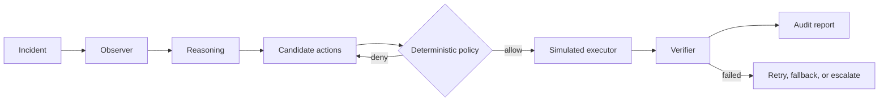

# Sentinel

Sentinel is a policy-gated incident-response agent that uses AI for evidence-grounded proposals while keeping authorization, simulation, execution, and verification deterministic and auditable.

## The problem

Incident responders must act quickly with incomplete evidence, but an unrestricted agent can turn a plausible recommendation into a costly outage. Sentinel separates reasoning from authority: the model can interpret observations and propose a supported action; it cannot change policy, see hidden simulator state, or execute remediation.

## The idea



The dashboard runs the complete product loop: detect a lateral-movement incident, collect four observations, reason locally or with NVIDIA Nemotron, simulate candidates, enforce policy, apply the authorized action to an isolated clone, verify reachability and payroll availability, and retain a structured timeline.

## Nebius + NVIDIA

`POST /reason` and the optional live path in `POST /incidents` call a configured NVIDIA Nemotron model through Nebius Token Factory's OpenAI-compatible chat-completions API. Sentinel requests strict JSON-schema output, then validates the incident ID, evidence references, action, and target locally. The response records the provider, model, request ID, latency, and token usage when Nebius returns it. No value is fabricated when usage is absent.

Set `NEBIUS_API_KEY` and a current NVIDIA Nemotron model ID in `NEBIUS_MODEL`. Without credentials, the full local demo still runs and explicitly labels its deterministic reasoning fallback. Credentials are never returned by `/config/model`.

## Safety

The deterministic policy engine is authoritative. A model proposal is never an authorization. Every candidate is simulated before policy evaluation, denied actions are never applied, and post-action recovery is independently recomputed. The demo's safety path proposes host isolation: although it stops the modeled attack, policy blocks it because it impacts two users and payroll, then authorizes the lower-impact account action.

All execution in this repository is simulation. Sentinel does not mutate real infrastructure.

## Research

The project contains frozen controller experiments v1–v5 and machine-readable JSON/CSV artifacts. Negative results are retained:

- On sealed v3, naïve retry beat the state-estimation controller on recovery, escalation, residual risk, and cost.
- On sealed v4, retry-then-fallback reached 0.71 resolution versus 0.44 for selective recovery.
- On 120 untouched sealed-v5 scenarios, retry-then-fallback resolved 27.50%; structural switching reached 30.00% but slightly worsened residual risk (1.0667 versus 1.0583).
- The 83.33% bounded-sequence oracle uses hidden execution state and is an offline diagnostic upper bound, not deployable performance.
- Every compared sealed-v5 method recorded zero policy violations under the frozen synthetic benchmark definition.

See [the research report](docs/RESEARCH.md), [evaluation protocol](docs/EVALUATION_PROTOCOL.md), and generated [sealed-v5 metrics](artifacts/sealed-v5/aggregate-metrics.json).

## Demo

```bash
uv sync --extra dev
uv run uvicorn sentinel.main:app --reload
```

Open `http://127.0.0.1:8000`, click **Run recovery**, then click **Show policy block**. The complete 2–3 minute script is in [docs/DEMO.md](docs/DEMO.md). OpenAPI is available at `/docs`.

## API

- `GET /health` — liveness.
- `GET /scenario` — deterministic world and separately modeled evidence.
- `POST /simulate` — the three frozen MVP counterfactuals.
- `POST /policy/evaluate` — deterministic allow/deny for a simulation result.
- `POST /reason` — live, validated Nebius/Nemotron reasoning; fails closed when unconfigured.
- `POST /incidents` — complete policy-gated product loop; accepts `use_live_reasoning` and an optional demo `proposed_action`.
- `GET /incidents`, `/incidents/{id}`, `/incidents/{id}/timeline` — in-memory reports and audit events.
- `GET /experiments` — checked-in sealed-v5 aggregate metrics.
- `GET /config/model` — safe configuration status, never credentials.

Incident reports are in memory for the demo and are lost when the process restarts.

## Running locally

Python 3.11+ is required.

```bash
uv sync --extra dev
cp .env.example .env  # optional; export values before startup
uv run uvicorn sentinel.main:app --host 127.0.0.1 --port 8000
```

For a credential-free smoke test:

```bash
curl -s -X POST http://127.0.0.1:8000/incidents \
  -H 'content-type: application/json' -d '{}'
```

## Tests

```bash
PYTEST_DISABLE_PLUGIN_AUTOLOAD=1 uv run pytest -q
```

The pre-change baseline was 84 passing tests. Run the command above for the current count; tests mock provider calls and never require paid inference.

Reproduce the frozen v5 evaluation without changing its config:

```bash
uv run --no-sync python -m sentinel.sealed_evaluate_v5
```

## Deployment

Build and run the same image locally or on a Nebius AI Cloud container/VM:

```bash
docker compose up --build
```

The image runs as a non-root user, exposes port 8000, and includes a `/health` health check. To deploy on Nebius, build and push `Dockerfile` to the chosen registry, create a container workload with port 8000, and inject `NEBIUS_API_KEY`, `NEBIUS_MODEL`, and optionally `NEBIUS_BASE_URL` as runtime secrets. No deployment URL is claimed because this checkout has no cloud credentials or provisioned target.

## Repository structure

- `src/sentinel/api` — FastAPI transport.
- `src/sentinel/services` — counterfactual and incident-loop orchestration.
- `src/sentinel/reasoning`, `providers` — strict model boundary and Nebius adapter.
- `src/sentinel/policy`, `simulator`, `execution` — deterministic safety, prediction, execution, and verification.
- `src/sentinel/decision` — production and research controllers.
- `src/sentinel/scenarios`, `evaluation` — seeded worlds and frozen benchmark harnesses.
- `src/sentinel/web` — dependency-free responsive demo dashboard.
- `artifacts` — checked-in machine-readable controlled and sealed results.
- `docs` — architecture, threat model, protocol, failure analysis, research, and demo script.

## Limitations

- Worlds, execution failures, and observations are synthetic; results do not establish real-world security effectiveness.
- Live Nemotron quality and repeatability have not been benchmarked in the checked-in results.
- The product demo uses one lateral-movement scenario and an in-memory incident store.
- Execution is simulated only; there is no production infrastructure adapter.
- The bounded oracle has privileged hidden state and cannot be compared as a deployable controller.

## Future work

Add a persistent report store, a sandboxed infrastructure adapter with rollback receipts, replay against redacted real incident traces, and operator studies. Any added recovery action should be justified by observed failure evidence and receive simulation, policy, execution, verification, and test contracts.
